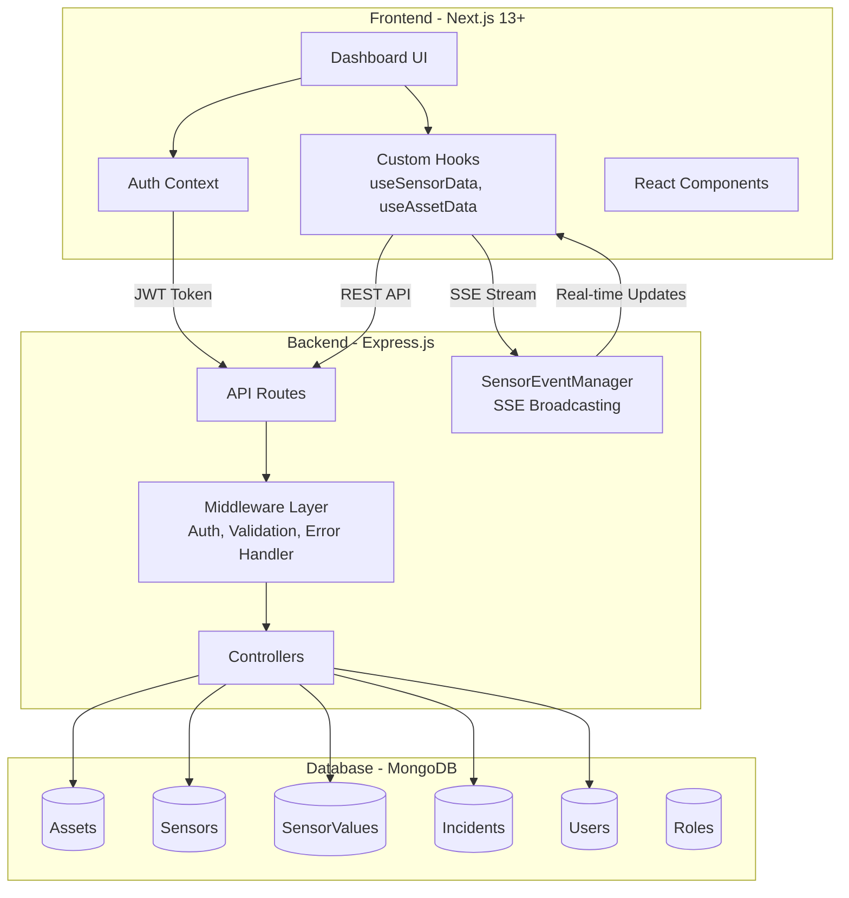
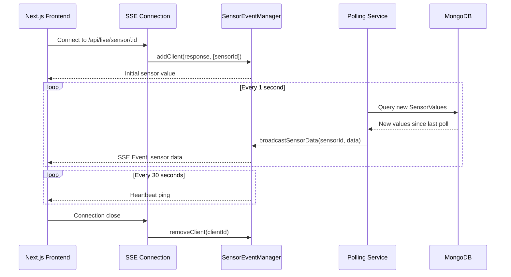
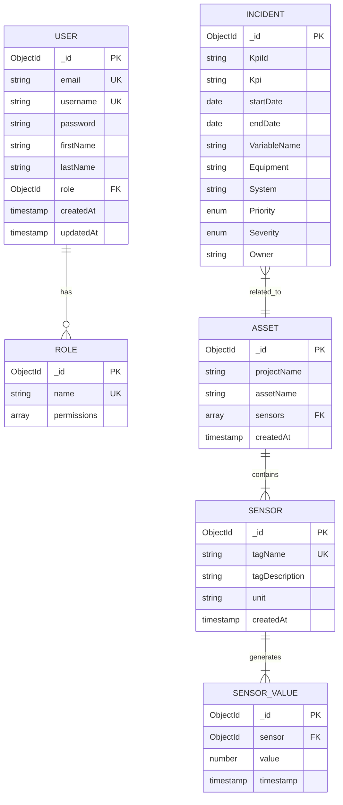
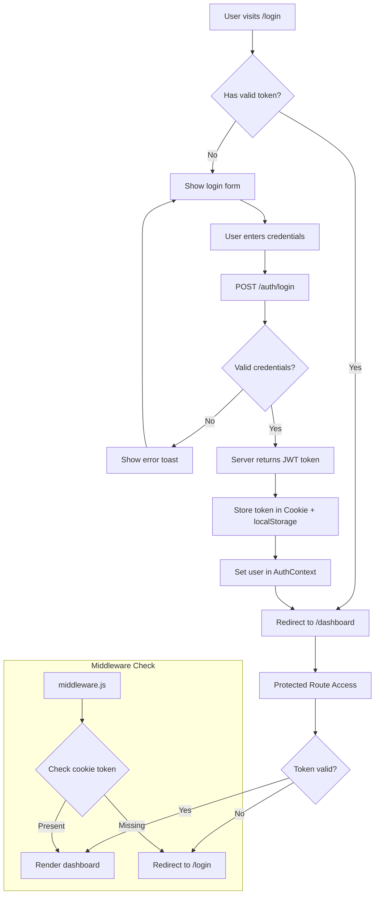
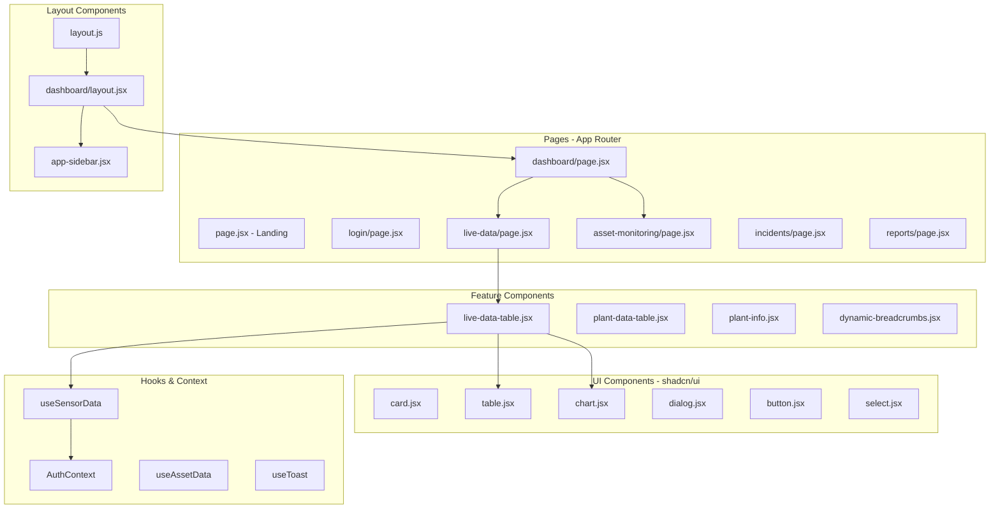
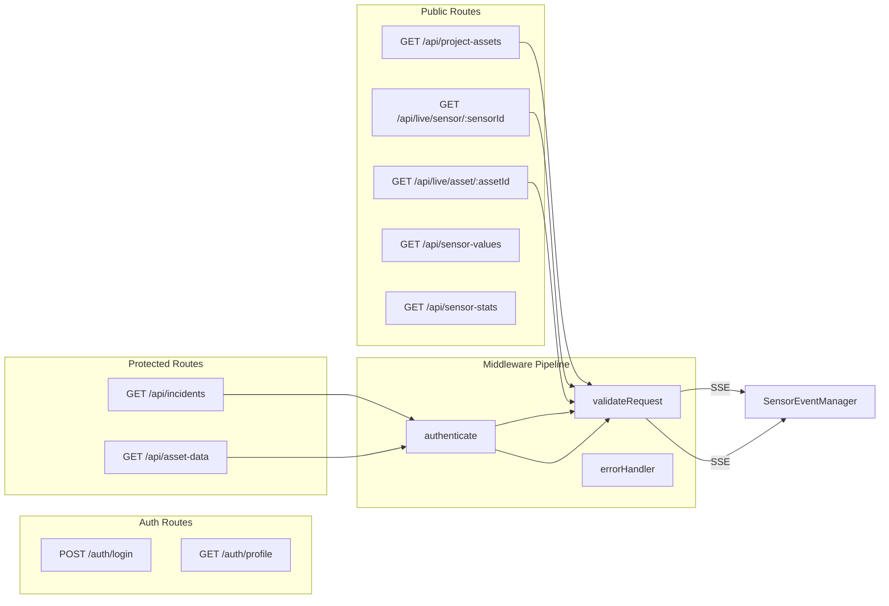
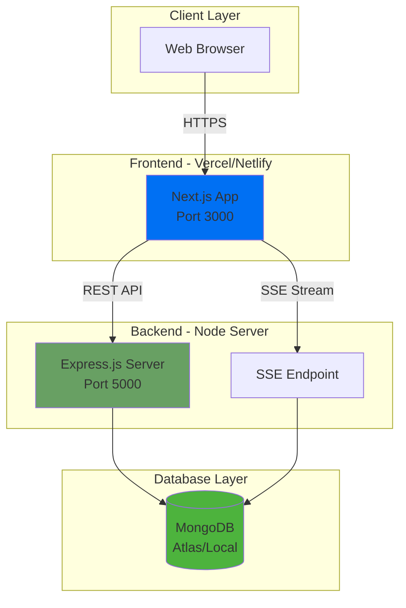
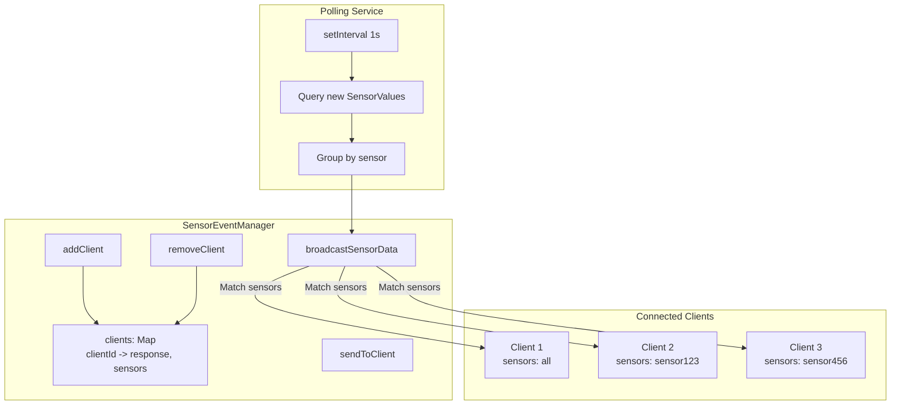

# RMDS - Power Plant Monitoring System Diagrams

This document contains Mermaid diagram code for visualizing the RMDS architecture.

## 1. System Architecture Diagram



## 2. Data Flow Diagram - Real-time Sensor Streaming



## 3. Entity Relationship Diagram



## 4. Authentication Flow Diagram



## 5. Component Architecture Diagram



## 6. API Routes Structure



## 7. Deployment Architecture



## 8. Server-Sent Events (SSE) Architecture



---

## How to Use These Diagrams

### Option 1: Mermaid Live Editor
1. Go to [Mermaid Live Editor](https://mermaid.live/)
2. Copy any diagram code block
3. Paste and export as PNG/SVG

### Option 2: VS Code Extension
1. Install "Markdown Preview Mermaid Support" extension
2. Open this file and preview

### Option 3: GitHub/GitLab
Both platforms render Mermaid diagrams natively in markdown files.

### Option 4: Generate with Python
```python
# Install: pip install mermaid-py
from mermaid import Mermaid

diagram_code = """
graph TB
    A[Start] --> B[End]
"""

mermaid = Mermaid(diagram_code)
mermaid.to_png("diagram.png")
```
